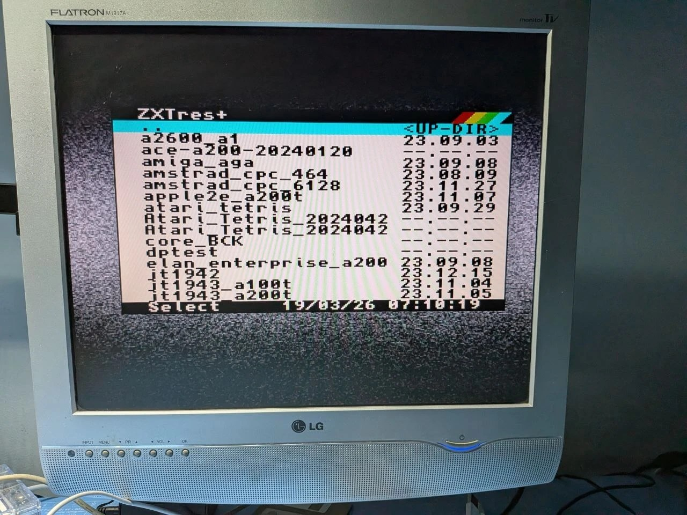

# MiST ports for the ZXTRES boards, with the ZX Spectrum theme

This is a fork of [ZXMicroJack/mist-ports](https://github.com/ZXMicroJack/mist-ports),
the ports of MiST cores to the ZXTRES, ZXUno and NeptUno boards. This fork
adds the **ZX Spectrum theme** to the menu core of the ZXTRES boards: an
opaque OSD in Spectrum colours with a title bar and a status bar
(`menu/zxtres/osd_zx.v`), the commands of the I/O controller that drive it
(`menu/zxtres/user_io_zx.v`) and its simulation (`menu/zxtres/sim`).

*The core menu of a ZXTRES+ with the theme.*

## The repositories of this improvement

The menu core needs the firmware of the middle board to draw the file
selector, the clock and the *About* page. Both go together:

| Repository | What it holds |
| --- | --- |
| [mist-ports](https://github.com/aitorgomez-net/mist-ports) (this one) | The menu core for the ZXTRES boards, with the themed OSD |
| [Menu_MIST](https://github.com/aitorgomez-net/Menu_MIST) | The generic menu core (submodule) with the hooks for the theme. Branch `zxtres-theme` |
| [mist-firmware-rp2040](https://github.com/aitorgomez-net/mist-firmware-rp2040) | The firmware build and the ready-made builds of the theme: start here to install it |
| [mist-firmware](https://github.com/aitorgomez-net/mist-firmware) | The firmware source (submodule): file selector, clock, *About* page. Branch `zxtres-theme` |
